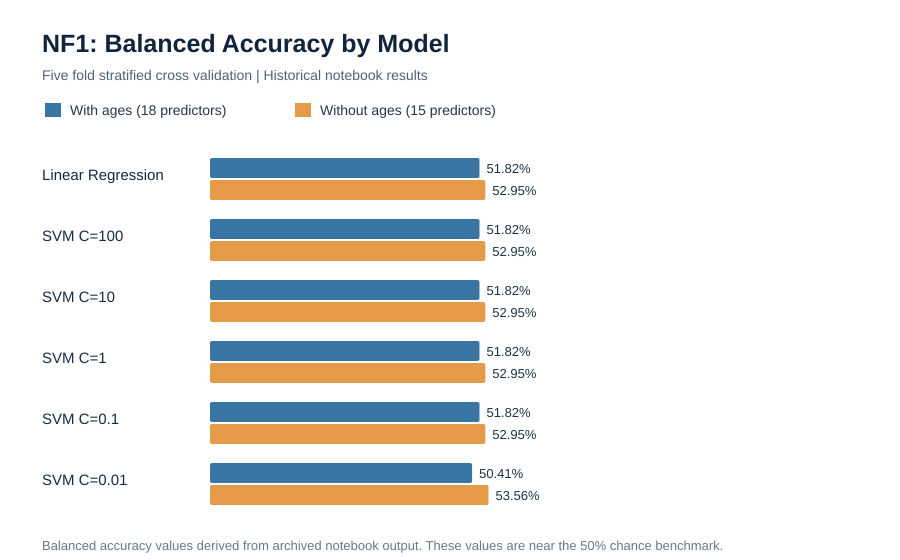

# Predicting Familial vs. Sporadic NF1 Cases

**Machine learning course project | Linear Regression vs. Linear SVM | NJIT DS675**

This project investigates whether clinical symptoms and age-related features can help distinguish **familial** from **sporadic** cases of neurofibromatosis type 1 (NF1).

It compares two linear modeling approaches using preprocessing and cross-validation. The aim is to study predictive performance, **not** to build a clinical diagnostic tool.

## Research question

Can simple linear models distinguish familial from sporadic NF1 cases using recorded clinical features? Does removing age variables change the results?

## Dataset

- Source: [UCI Machine Learning Repository, Dataset 1162](https://archive.ics.uci.edu/dataset/1162/neurofibromatosis+type+1+clinical+symptoms+of+familial+and+sporadic+cases)
- File used in the original notebook: `dataset-uci.xlsx`
- Working table in archived notebook: **296 records**, 161 sporadic and 135 familial
- **18 predictors** and a `Case Type` target (0 = sporadic, 1 = familial)
- Two feature sets: 18 predictors with ages, and 15 after removing three age features

**Data version note:** The UCI listing describes **331 instances**, while the working table in the original saved experiment contained **296 records**. This difference has not been reconciled. Reproduction with a different dataset version may produce different results.

The dataset is attributed to Sharafi and colleagues (2025). See [data/README.md](data/README.md) for the dataset source and setup.

## Method

- Missing age values: median imputation within each training fold
- Numerical preprocessing: `StandardScaler` within each fold
- Models: `LinearRegression` with predictions converted to binary labels using a 0.5 threshold; `LinearSVC` with `C` of 100, 10, 1, 0.1, and 0.01
- Evaluation: stratified 5-fold cross-validation (`shuffle=True`, `random_state=42`)
- Metric: mean balanced accuracy across the five held-out folds
- Comparison: with and without age variables

## Results from the saved notebook run

| Model | C | With ages: balanced accuracy | Without ages: balanced accuracy |
|---|---:|---:|---:|
| Linear Regression | N/A | 51.82% | 52.95% |
| Linear SVM | 100 | 51.82% | 52.95% |
| Linear SVM | 10 | 51.82% | 52.95% |
| Linear SVM | 1 | 51.82% | 52.95% |
| Linear SVM | 0.1 | 51.82% | 52.95% |
| Linear SVM | 0.01 | 50.41% | **53.56%** |

The best observed mean balanced accuracy was **53.56%**, from Linear SVM (`C=0.01`) without age features. All results were close to 50%, indicating limited predictive separation using these models and features.

## Repository contents

- [`notebooks/nf1_analysis.ipynb`](notebooks/nf1_analysis.ipynb): analysis adapted from the actual Google Colab experiment
- [`figures/age_feature_comparison.svg`](figures/age_feature_comparison.svg): results summary chart
- [`data/README.md`](data/README.md): dataset source, attribution, and setup
- [`requirements.txt`](requirements.txt): Python dependencies

## How to run

1. Download `dataset-uci.xlsx` from the [UCI dataset page](https://archive.ics.uci.edu/dataset/1162/neurofibromatosis+type+1+clinical+symptoms+of+familial+and+sporadic+cases).
2. Place it at `data/dataset-uci.xlsx` inside the repository.
3. Install dependencies with `pip install -r requirements.txt`.
4. Open `notebooks/nf1_analysis.ipynb` in Jupyter or Google Colab and run the cells from top to bottom.
5. Check the loaded row count and label distribution. If they differ from the original working table, expect results to differ.

The notebook has been adapted to remove Google Drive mounting and ZIP extraction setup. **It has not been fully reexecuted against a local copy of the original Excel dataset**, so full reproducibility remains unverified.

## Limitations

- Modest working sample size and overlapping clinical symptoms
- Balanced accuracy near chance level; **not for clinical use**
- Only linear models were compared in this project
- No independent final untouched test set; configurations were compared using the cross-validation results
- Removing age variables slightly improved scores, but this does **not** establish that age is clinically irrelevant
- Data version discrepancy requires investigation

## Attribution

**Dataset and associated research:** Sharafi, P., Arslan, H., Ersoy, S., Varan, A., and Ayter, Ş. (2025). *Neurofibromatosis Type 1: Clinical Symptoms of Familial and Sporadic Cases*. UCI Machine Learning Repository. See [dataset listing](https://archive.ics.uci.edu/dataset/1162/neurofibromatosis+type+1+clinical+symptoms+of+familial+and+sporadic+cases) and [associated paper DOI](https://doi.org/10.5505/TurkHijyen.2025.06337).

This repository is an educational experiment, not medical advice.
